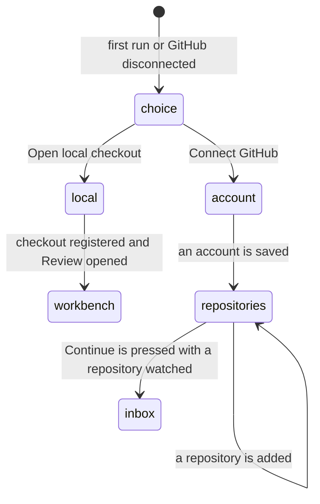

# Workspace setup on Pull requests

## Summary

On first run, the Pull requests screen offers **Open local checkout** and **Connect GitHub**. A disconnected workspace shows these actions instead of an authentication error or an empty pull request listing. Local Reviews need Git, but no GitHub CLI, account, remote, or watched repository. GitHub setup begins only after Connect GitHub.

## The simple case

On a new installation, choose Open local checkout. Select a Git checkout in the folder picker, then pick Shared or Commit in the source dialog. Registering the first checkout saves the Default workspace with GitHub disconnected. Cancelling the folder picker saves nothing. See [Opening a local Review](../pull-requests/opening-a-local-review.md).

For pull requests, choose Connect GitHub. The two numbered cards then appear. `1. Reviewing as` states the account the GitHub CLI resolved, or offers a selector when several are authenticated. Saving an account connects the workspace. Without a stored workspace, it writes Default.

`2. Repositories` appears once an account is saved. The maintainer types a repository such as `acme/api` into `Add a repository` and presses Add; each added repository saves at once, so several can be added in one pass. A repository's checkout is optional here and can be chosen from its row; see [Watched repositories and checkouts](watched-repositories.md). Once at least one repository is watched, a Continue button appears at the end of setup; pressing it opens the inbox.

## The task, event by event

### Arrive

The page heading is `Set up your workspace`. The filter toolbar, table, pager, and details panel are absent. The titlebar's Open local checkout action and the [Visited pull requests column](../foundations/visited-pull-requests.md) remain available. A disconnected workspace does not poll GitHub or probe credentials. Local errors stay with the checkout action.

After Connect GitHub, one environment read serves the account cards. `1. Reviewing as` renders what the GitHub CLI reports. Below it, and only when that read says Git is missing, one line says `Git is not installed. Install Git for this platform, then re-check.` Patchdesk installs and logs in to nothing.

Until an account is saved, the second card is replaced by the line `Choose an account first.` The watchlist needs a saved workspace, which the account save is what creates.

### Leave unchanged

Reading the cards, waiting for the environment read, and pressing Re-check change no saved value. Cancelling a checkout's folder picker leaves the row as it was. Nothing here opens Settings.

### Begin an action

Choosing an account in `1. Reviewing as` saves it. When the GitHub CLI reports exactly one authenticated account, Patchdesk adopts it once by itself and saves it the same way. Manual GitHub account and host fields commit on blur and on Enter.

Add in `2. Repositories` writes the repository to the watchlist; Stop watching removes it. Re-check re-reads the environment.

### While the action runs

The control that committed says `Saving…` beneath itself, then `Saved`. Add is disabled while its request runs. A repository row shows its own pending state while its request runs.

A save that fails leaves the previous saved value in place and reports the reason beside the control that caused it. Setup does not move on to the next card until the value it needs is actually saved.

### Settle

A saved account makes `2. Repositories` appear. An added repository appears in the watched list with `No checkout chosen` until a checkout is chosen.

Setup stays on screen after the first repository is watched and ends when the maintainer presses Continue, at which point the Pull requests listing replaces it. Review-opening progress and errors stay scoped to their workspace, so a late result from another one cannot show a stale `Could not open review` alert over setup.

## Variants

| Variant                                                | Before the action runs                                                                                                | While the action runs                                                                                                 |
| ------------------------------------------------------ | --------------------------------------------------------------------------------------------------------------------- | --------------------------------------------------------------------------------------------------------------------- |
| Workspace profile and GitHub account                   | Default remains in memory until the first registration or account save.                                               | Local registration saves a disconnected workspace; an account save connects GitHub.                                   |
| Pull request and Review state                          | A disconnected workspace offers local setup without a watchlist.                                                      | Opening a local checkout can create a Review immediately. GitHub listing starts after account and repository setup.   |
| GitHub permissions and merge readiness                 | Local setup needs no GitHub permission. Connect GitHub needs an authenticated account, not merge permission.          | Saving is local. Repository permission failures appear later, on the first listing read.                              |
| Network, local tool, and Insight provider availability | Local setup needs Git. The GitHub CLI supplies accounts only after Connect GitHub. Insight providers are not queried. | Checkout errors remain on the local path. A failed account probe offers Re-check.                                     |
| Input path: mouse, keyboard, or desktop menu           | The cards are the same controls Settings renders, and are keyboard operable.                                          | Commit on Enter and commit on blur reach the same save. Choose checkout's macOS folder picker temporarily owns focus. |

## Cancel and interrupt

| Event                                                                                                 | Before the action runs                                                                                | While the action runs                                                                                             |
| ----------------------------------------------------------------------------------------------------- | ----------------------------------------------------------------------------------------------------- | ----------------------------------------------------------------------------------------------------------------- |
| Cancel, Stop, or Escape                                                                               | There is no setup-wide Cancel or Stop. Escape has no effect here.                                     | A save and a watchlist write have no Stop control; each settles or fails on its own.                              |
| Navigate to another Patchdesk screen, Review, Settings section, or workspace profile                  | Navigation proceeds; setup holds nothing unsaved. Settings → Workspace shows the same two cards.      | Leaving does not cancel a request in flight. Returning re-reads the environment and the workspace.                |
| Start another action or request a refresh                                                             | Re-check and Refresh are separate reads. Neither edits the workspace.                                 | A newer Re-check owns the visible result. A reload after a save is what makes the next card correct.              |
| GitHub, the network, a local tool, or an Insight provider fails or times out                          | Setup is reachable without any successful GitHub read; the empty state is local.                      | The affected control reports its own failure. Nothing retries by itself; Re-check and re-committing are explicit. |
| Close Settings, reload the renderer, close the window, or quit Patchdesk                              | Saved account, watchlist, and checkouts survive. Probe results do not.                                | A reload drops in-memory status. The next load starts from what was actually saved.                               |
| The pull request, represented revision, pending review, permission, or other target changes elsewhere | No pull-request target exists yet. Another workspace becoming active changes what setup is asked for. | The next inbox load is authoritative for whether setup is still needed.                                           |
| macOS focus, a file or folder picker, or another input path takes control                             | Cancelling Choose checkout's folder picker changes nothing.                                           | Focus loss does not cancel a watchlist write. Blur is itself a commit.                                            |

## Interactions with other systems

**Workspace profile and identity.** Local registration creates a disconnected Default workspace when needed. Connect GitHub uses the same workspace editor as Settings → Workspace.

**Review revision and freshness.** The local path opens a captured Git revision. The GitHub path establishes no Review session until a pull request is opened.

**Local persistence and recovery.** Before the first registration or account save, Default is held in memory. Either action saves it. Registrations, account, watchlist, and checkouts survive restart. Environment results are re-creatable.

**GitHub permissions and write authority.** Nothing here writes to GitHub. A resolved account proves only that the GitHub CLI reports it as authenticated.

**Network, local tools, and Insight providers.** Opening a local checkout reads only the selected Git repository. The GitHub account probe runs only after Connect GitHub. Insight providers are not consulted.

**Concurrent operations and locking.** Saves compose and the newest response wins. Watchlist writes are per repository, so one slow row does not block another.

**Feedback, errors, and diagnostics.** Every control reports its own state: `Saving…`, `Saved`, or the reason it failed. No credentials or raw command output are shown.

**Preferences, keyboard commands, and desktop integration.** Setup shares the Pull requests screen's Refresh behavior; Choose checkout uses the native folder picker.

**Supported input and accessibility limits.** Mouse and keyboard are in scope. Screen-reader behavior is outside the supported product claim.

## Edge cases

- If first local setup stops before the workspace becomes active, repeat Open local checkout or `patchdesk setup add-checkout`. Setup keeps any saved repository registrations and adds the requested checkout if needed. A damaged registration catalog is refused without replacing it.
- The Git line appears only when the environment read says Git is missing. A missing or unauthenticated GitHub CLI is reported by the account card itself, not by a separate tools list.
- A workspace that already watches a repository does not show setup, even when the latest read returns no pull request; that is a different settled state.
- A late Review-opening result from a prior workspace is ignored when the current one reaches setup.
- A workspace that stopped watching its last repository still lists the Reviews it opened in the Visited pull requests column beside setup, and a row there opens that Review.

## Open questions and verification

- The in-place setup flow still needs a live check with an empty watchlist. The checklists in `verification/` describe the previous card.
- Confirm how the Visited pull requests column looks beside setup on a fresh install.
- Confirm where focus lands when Continue replaces setup with the listing.
- Confirm what a fresh install shows between the account save and the first environment read settling.
- Confirm the presentation when the account save fails on a machine with no stored workspace.

Baseline drafted from Patchdesk application source commit `3100615`; revised and verified against `737c515c`.
