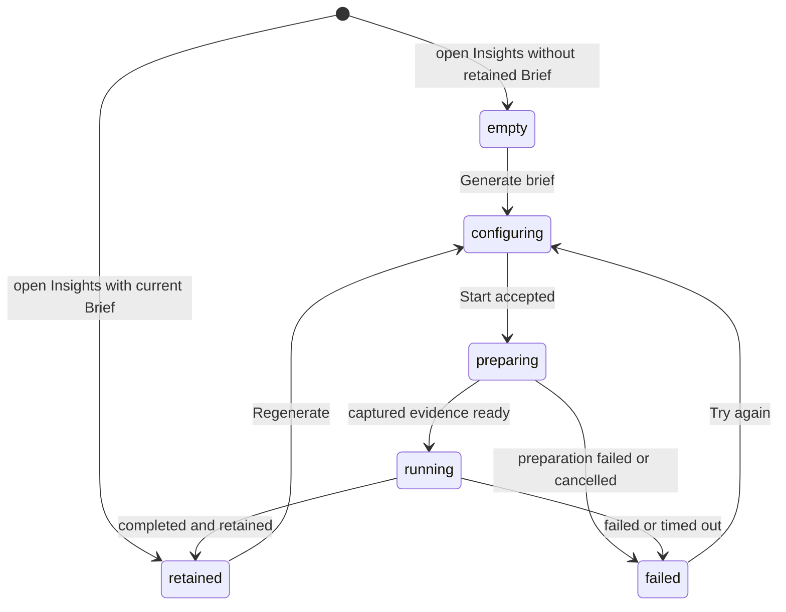

# Brief

## Summary

Brief gives the maintainer a reading orientation for the represented Review before detailed inspection. It combines model-drawn Flow views with deterministic signals, change shape, and reach, retained for the exact Review session. Brief is the first tab in the Insight tab strip, and Insights opens on it unless only a later Insight has a retained result. A retained Brief remains readable even when a new Insight run cannot start. Generating or regenerating a Brief requires an open Review.

## The simple case

The maintainer chooses Insights and lands on Brief, or chooses its tab. Patchdesk shows what changed, how the files group by directory, which hunk supports each changed step, and what the change may reach. If no current Brief exists, a borderless empty state centers the Brief icon, the heading "No brief yet", a one-line explanation, and the Generate brief action in the available reader space. The maintainer generates one with an available provider and model. For a reading path through the files, a retained Brief can open the Walkthrough for the same revision or offer to generate one.

## The task, event by event

### Arrive

Brief occupies the Insights slot for the represented Review. The Insight tab strip reads Brief, Guide, Walkthrough, Analysis. A tab with a current result has no mark; Running shows a spinner, Outdated an amber clock, and Failed a red circle-x, each naming its state in a tooltip; a Not run tab has no icon and a dimmer name. Insights opens on the first of Brief, Guide, Walkthrough, and Analysis that has a retained result, and on Brief when none has one; a restored or explicitly chosen Insight wins over that rule.

A retained result is laid out in two columns on a wide window and one column on a narrow one. The main column starts with Signals, then holds the Moves view when the patch moved files between directories, up to five Flow views, one per behavior, the grouped Shape tree, and the Blast radius view, whose No matching test row appears when it found something and otherwise folds into a "Nothing found:" line that names it and opens it. The side column holds the Scope card and the Provenance card.

The Provenance card lists the Revision as a short commit hash, when the Brief was Generated as a local date and time, the Provider and model when the run recorded them, and Citations as "all cited hunks found in the diff", "some citations or file paths could not be matched to the diff", or "no hunks cited" when no Flow step cites a hunk. A found citation means the hunk exists in the diff; it does not verify the step it supports. The card ends with a Regenerate button.

At the right end of the tab strip, a muted meta line says when the Brief was generated, for example "Generated 7h", or "Outdated · generated 7h" for an earlier revision. A result written in a language other than English also names it, for example "Generated 7h · Vietnamese". Unlike the Analysis and Walkthrough meta lines, it does not repeat the provider and model, because the Provenance card states them. The meta line also carries its own Regenerate button, so a current Brief shows Regenerate in two places. Before Regenerate, a walkthrough button reads Open walkthrough when a current Walkthrough exists for this revision and opens the Walkthrough tab; otherwise it reads Generate walkthrough and opens the Walkthrough run dialog. While the Brief is running, neither walkthrough button is shown.

Older retained Briefs can lack Blast radius or Moves because those fields did not exist when the artifact was stored. Patchdesk omits an absent legacy block without inventing data. When Blast radius was attempted but could not answer, the reader says "Blast radius was not counted:" and names the reason.

### Leave unchanged

Reading, opening a citation popover, copying a Flow view, and leaving the tab do not start a provider or change GitHub. Opening an existing Walkthrough also leaves the Brief artifact unchanged. Closing the Insight run dialog before Start, or the Run Insights dialog before Start N Insights, records nothing.

### Begin an action

Generate brief, either Regenerate button, Try again on a failed run, and Run for latest revision on an outdated Brief all open the Insight run dialog. The dialog is titled Run Brief, Regenerate Brief, or Run Brief again. It has four controls: Provider, with Codex CLI account and pi CLI account; Model, a searchable list of the provider's models; Reasoning, the effort levels the chosen model supports; and Language, English or Vietnamese. Language defaults to English and sets the language of the model's explanatory prose. In every language, the prompt asks the model to keep domain names and technical terms as they appear in the supplied repository evidence, alongside exact paths, identifiers, and Flow steps. A Vietnamese Brief writes its ownership notes in Vietnamese. Labels and buttons stay English. Changing Language does not mark an existing Brief outdated.

Choosing Codex CLI account shows Load Codex models, and choosing pi CLI account shows Load pi models. Models load only after that explicit action; once loaded, Refresh models replaces the list. The pi CLI account list identifies models as `provider/model`. Discovery checks the installed CLI and login; an unavailable or unsupported installation leaves generation disabled and explains the missing prerequisite. Closing the dialog while models load cancels that dialog's ownership of the request without reporting the provider as unavailable. Reopening can load models again.

Saved Brief preferences seed the dialog when its native provider is available. For a retired API-key choice or unavailable provider, Patchdesk preselects the most recently used available native account in this workspace and its model. It keeps supported reasoning or uses the model's default. Without a recent native choice, it uses the first available native account and default model. Existing preferences without recency follow that same default. A short notice explains the replacement. Accepting Start selects that native choice; only an accepted start saves it. Opening or cancelling saves nothing. Start stays disabled until an available model is selected.

Generate brief and both Regenerate buttons are disabled unless the Review is open and at least one native Insight provider is available. A merged or closed Review draws neither Generate brief nor either Regenerate button; the header's Merge chip already says the Review is merged or closed. When no provider is available, the reader says "No native integration available. Install Codex or Pi CLI on the app launch PATH and log in externally." When the catalog cannot load, it says "Could not load the model list. Reopen the Review to try again." A retained native result does not show an API-retirement warning merely because the saved next-run preference is retired. Historical API provenance still reads API key.

Run Insights…, beside the Insight tab strip, opens one dialog with a row for each Insight. Each row has a checkbox and actual Provider, Model, Reasoning, and Language values, seeded from its saved preference. Shared controls show a common value when selected editable rows agree and Mixed when they differ. An explicit shared edit changes only checked, non-running rows. Optional row overrides allow an individual choice; shared values then reflect any differences. Model and reasoning choices must be compatible with every selected editable row. Replacement notices remain visible outside the overrides. Checking another Insight keeps every other row's provider and model. Guide and Walkthrough also keep their native billing disclosure visible there.

By default only Insights without a current result for this revision are checked. A running Insight is unchecked and disabled, with its status beside it. Explicit Load models and Refresh models work as in the single dialog. The button reads "Start N Insights" and starts each checked Insight separately; only an accepted start saves that row's preferences and approves its waiting agent request. The action stays disabled until a row is checked and every checked row has a valid model. Run Insights… is disabled without an available provider and hidden on merged or closed Reviews. Refresh and new heads never start generation automatically. Generate brief, Regenerate, Try again, and Run for latest revision keep the single-Insight dialog.

In a narrow Run Insights dialog, shared controls and expanded row overrides wrap to the available width. The dialog scrolls to keep all rows and the start and cancel controls reachable.

Brief, Analysis, Guide, and Walkthrough offer the same two native providers, including Regenerate, Try again, and agent-request approval. No API-key executor or automatic paid-provider switch remains. Native account model choices carry no API list-price quote. Guide and Walkthrough explain that recorded native turn starts are not exact provider-request or billable counts. See [Walkthrough](walkthrough.md#begin-an-action) and [Guide](guide.md#begin-an-action).

Starting the run binds it to the current profile, Review session, represented head, and patch. Regeneration does not erase the retained Brief before a replacement completes.

### While the action runs

The run captures the represented revision before generation. The model reads the captured diffs as plain files, without full-file snapshots or review context. A newer checkout or pull request revision cannot replace those bytes. Missing or changed required evidence fails the run and keeps the previous result readable. See [local storage and privacy](../cross-cutting/local-storage-and-privacy.md#while-the-action-runs) for account-provider permissions and diagnostic detail.

Start changes to Starting…, and the dialog cannot be closed until the start request answers. If the start request fails, the dialog shows "Insight run did not start." with "Brief could not start. Check the run options and try again."

In the Run Insights dialog, Start N Insights changes to Starting…, and the dialog cannot be closed until every start answers. When every start is accepted, the dialog closes and each queued Insight's tab shows Preparing. A refused start shows "Brief did not start." with the same reason on its own row, while the other checked Insights still start. The dialog then stays open: the started rows read as running, and Start N Insights starts only the rows still checked.

Accepted Brief, Walkthrough, Analysis, and Guide runs first show Preparing while Patchdesk builds their captured evidence. The run already has a saved identity, so the dialog can close before that work finishes. The tab and reader change to Running only when provider execution starts, and to Cancelling after cancellation is confirmed as pending. A preparation failure settles the saved run without invoking a provider.

If the start response is lost or another start reports an existing run, Patchdesk reads the Review once and adopts its saved active run. It does not repeat Start automatically. If that read finds a new saved result or run failure, Patchdesk shows that terminal outcome. If it finds only the previous result, the start failure stays visible.

The running reader uses one compact phase and action block for Preparing, Running, or Cancelling, with elapsed time when available. Cancel requests cancellation; it does not declare the process stopped. A retained Brief stays readable below the block during replacement.

When Codex supplies a bounded activity trace, an Activity disclosure starts closed. Opening it shows the last reasoning summary line and command rows with their status and duration. No Activity control appears for an empty or unavailable trace. Codex uses native automatic approval review; Patchdesk checks effective policy before generation and refuses unsupported or changed settings. Activity is not reconstructed from native history and can disappear after a renderer reload.

> Technical note: commands are shortened to 200 characters, with paths inside the represented worktree made relative and the home directory shown as `~`, before they leave the main process. Command output is never shown. The trace is held in memory only; see [ADR 0043](../../adr/0043-project-a-bounded-codex-activity-trace.md). The command approval boundary is recorded in [ADR 0016](../../adr/0016-use-the-local-codex-cli-account.md).

Patchdesk polls the run by its durable identity. Cancel requests cancellation, but final state still comes from the run status. A transient status-read failure does not discard run identity: the reader says "Brief status refresh failed; still running."

Provider unavailability, invocation failure, timeout, invalid output, or cancellation settles without replacing the retained Brief. The generated content itself is not used to authorize GitHub writes.

A Codex CLI account run sends the Brief JSON Schema with its turn request, so Codex holds its answer to the Brief's fields and limits while it writes it. Codex requires every field in that schema, so an optional block the model leaves out arrives as `null`, and Patchdesk reads it as absent. Patchdesk still validates the returned result and its citations.

A pi CLI account run starts a fresh `pi` with captured evidence and native inspection tools, including Bash. Bash is not an enforced read-only shell. Edit and write tools remain excluded. Inherited extensions, MCP, skills, templates, themes, and context files are disabled. Pi has no output schema, so the prompt carries the result contract and Patchdesk validates the result. A pi dialog is answered as cancelled.

> Technical note: the provider boundary is recorded in [ADR 0054](../../adr/0054-use-the-local-pi-cli-account.md).

### Settle

On success, Patchdesk retains the new Brief for this session and renders its structured sections.

Flow draws up to five diff-styled views, one for each behavior the change touches, so two unrelated call paths get two call-tree views; when the model proposes more, a line under the views says how many were not shown. Each view has a kind — call_tree with real function or method signatures like `validateManualDays(command, suggestion)`, control_flow as short pseudocode lines like `on(save)`, component as a UI tree like `<SessionToolbar>`, state as state names with their transitions like `→ failed on timeout` under each state, and contract as an exported name with its old and new signature rows — each marking a step added, removed, or unchanged in a marker-column row with tree guides, so the maintainer can see whether the change added a step, dropped one, or reordered around it. Each step stays on one line; a step too long for the view ends with an ellipsis and shows its full text on hover. Citation chips sit in their own column at the right of each row and appear only on changed steps and on a contract's exported name. A chip shows the hunk alias, such as `h3`, and names the file on hover. Hunk citations are best effort — a changed step with a cited hunk shows a chip that opens the hunk; a changed step the model could not place in the diff is kept, drawn with a muted marker and no chip, and Provenance reads "some citations or file paths could not be matched to the diff". A contract view carries its chips on the exported name at its root; its signature and field rows show no chip and no muted marker, and they count as uncited only when the root cites no hunk. Flow draws no contract view for a test file or a fixture. A tree left with no surviving changed step is dropped, and Flow itself is absent when no view survives. Each view carries a kind badge and its own Copy as diff action, copying that view back out as fenced diff text for pasting elsewhere. The button reads Copied for about 1.5 seconds after the clipboard accepts the text.

Signals is a fixed set of checks, always drawn in the same order in three groups, so the reviewer sees what was checked as well as what matched. Areas: Public API (API, proto, OpenAPI, `cmd`, versioned package paths, `.d.ts`), Routes (added or removed route registrations such as `r.POST(` or `app.get(` in code), Stored data (migrations, `.sql`, schema files), Security boundary (workflows and auth, permission, credential, or secret code), Dependencies (manifests and lockfiles, marked "lockfile only" when no manifest changed), and Config or deploy (`.env`, config folders, Dockerfile, compose, Kubernetes, Helm, Terraform, `deploy/`). Tests: Tests weakened (deleted test files, removed assertions, `.skip` or `.only` added, five or more snapshot files updated) and Tests added (new test cases and files). Code: Concurrency (an added goroutine, channel, lock, atomic, `select`, `Promise.all`, `setInterval`, or worker, outside tests and mock folders) and To skim (files that only moved, only follow a move, or are generated). Signals leaves out what a linter or secret scanner already catches, such as debug output, ignored errors, secrets, and injection patterns. A matched row is tinted, with a solid dot, its count, a short breakdown, and its first paths; a row at zero is dimmed with a dash. Files that only moved or follow a move raise no row but To skim. Patchdesk computes every row from the patch; no model is involved. The PR description a local Review copies lists the matched rows only.

Moves lists the directories the patch moved files between, from git's rename data with no model involved, for example `api/cmd/ → cmd/api/  20 files · 1 also edited`. It appears when at least two renamed files changed directory; a rename inside one directory is not a move. Directories that differ only in one repeated name merge into one row, such as `job/<name>/cmd/server/ → cmd/<name>/  13 files · 6 names`. The six largest rows show, and a counted line stands for the rest. The heading also counts Go and JavaScript-family files the patch edits only to follow the move: the file swaps an import for one that points into a directory a file moved to, and every other changed line matches its removed line in order once a package qualifier those import changes renamed is set aside, such as `sharedmocks.NewRepo(t)` becoming `bulkupdatemocks.NewRepo(t)`. A file that only adds an import or export, or reorders its code, is a real change. Moves comes before Flow when moved files plus those reference updates outnumber added files, removed files, and the remaining modified files each; otherwise it follows Flow. Shape drops a note on a renamed file whose content did not change, whether or not Moves appears, because the file owns nothing new.

Shape groups files by directory and collapses a directory after twelve files into a counted remainder. When many files in one directory share one job, such as fixtures or config files, the model can note the directory once instead of each file; that note sits beside the directory, or beside the first directory under it, and a note on a directory with no changed file is dropped. Each file's note is cut to one line until Show full notes wraps every note in full; Shorten notes cuts them again. Evidence uses its shortest meaningful identifier while preserving full paths in titles. Blast radius answers what the change could affect in files it doesn't touch. It checks every export the patch declares on an added or removed line, every existing export whose body the patch changes, and any other changed name the model lists, up to twenty names. Each line outside the changed files that names one of them is a mention site: the function, method, or class the line sits in (or top level), its line number, and its kind. A line shaped like a call, `new Name`, or `Name.` is a call; an annotation, type argument, `extends`, `implements`, `as`, or `import type` is type-only; any other import is an import; the rest is other. A summary line counts the functions that call a changed name and the type-only mentions, then names the layers they sit in (main, services, renderer, adapters, domain, runtime), or says that nothing outside the changed files mentions a changed name. Removed names still mentioned elsewhere come first, then changed names mentioned elsewhere, most files first. Each name shows its count by kind, with test files counted once as tests, and its files grouped by folder, source folders before test folders; under each file its sites are listed calls first. Past five sites a "+N more" button shows the rest, and sites past the thirty kept per name read as "+N not listed". A Brief stored before mention sites existed shows files instead: counts split into source and tests, a summary of affected files, and "+N more" past five files. Names nothing outside the changed files mentions, usually names the change adds, fold into one line that counts how many are new and how many changed and opens to list them. The footer says the names were found by text search, so a mention is a place to check, not proof of a call. The No matching test row lists changed code files that no changed test file matches by name, folder, or mention; only source files are listed, so docs, config, build files such as a `Makefile`, and test doubles under a `mocks` folder are left out, and no test is run.

The Scope card shows the current revision's Scope, so its rows work on an outdated Brief too. Each bucket with files is a button, such as "Filter the Diff to Tests", that opens the Diff tab on Browse filtered to that bucket, leaving any commit, since-review, or other patch view. It applies the same Scope filter as the diff toolbar's Scope picker, so the picker then shows the bucket and Clear scope removes it; see [Files, diff, commits, and navigation](files-diff-and-navigation.md#begin-an-action). The filter is not saved.

A failed run shows a concise explanation, its available recovery action, and whether the previous Brief remains readable. Most failures offer Try again. Missing or changed represented files offer Re-prepare Review instead; it rebuilds through the durable refresh lifecycle and then opens the run dialog for explicit confirmation. It never runs automatically when the Review opens. Details holds revision and run metadata and safe native attempt information. Load attempt details fetches a bounded page; More attempts replaces that page when available. The first host failure stays separate from capture and cleanup outcomes. Native bodies and private paths are not displayed, and missing history does not remove recovery. Available command activity remains behind its closed disclosure. An outdated Brief names both revisions and offers Run for latest revision. A merged or closed Review draws none of these run actions.

## Variants

| Variant                                                | Before the action runs                                                                                                                                                                                                 | While the action runs                                                                                                 |
| ------------------------------------------------------ | ---------------------------------------------------------------------------------------------------------------------------------------------------------------------------------------------------------------------- | --------------------------------------------------------------------------------------------------------------------- |
| Workspace profile and GitHub account                   | The active profile selects local rules, checkout context, and available provider configuration.                                                                                                                        | A profile change leaves the Review; the old run stays bound to its original session.                                  |
| Pull request and Review state                          | Brief can be read for represented open or terminal Reviews. Generation requires an open Review, a valid current session, and patch context; on a merged or closed Review, Generate brief and Regenerate are not drawn. | A newer remote revision does not rewrite the artifact; the result remains evidence for the represented revision.      |
| GitHub permissions and merge readiness                 | Brief reading and generation do not require GitHub write permission or merge readiness.                                                                                                                                | The run cannot approve, comment, or merge. Its output becomes actionable only through separate explicit controls.     |
| Network, local tool, and Insight provider availability | Retained sections can be read without a provider. Generation needs an available provider; with none, the reader names the missing configuration and the generate controls stay disabled.                               | Provider, network, local-tool, timeout, or output failure leaves the prior retained Brief intact and retryable.       |
| Input path: mouse, keyboard, or desktop menu           | Insights tabs, reader controls, run dialog, and citation chips support mouse and keyboard.                                                                                                                             | Cancel, close, and retry use the same run identity from either input path. Desktop menus do not start an Insight run. |

## Cancel and interrupt

| Event                                                                                                 | Before the action runs                                                                                                                                                 | While the action runs                                                                                                                               |
| ----------------------------------------------------------------------------------------------------- | ---------------------------------------------------------------------------------------------------------------------------------------------------------------------- | --------------------------------------------------------------------------------------------------------------------------------------------------- |
| Cancel, Stop, or Escape                                                                               | Cancel or Escape in the run dialog before Start records nothing.                                                                                                       | The dialog cannot close while Start is pending. Cancel in the header requests run cancellation; Escape does not declare a provider process stopped. |
| Navigate to another Patchdesk screen, Review, Settings section, or workspace profile                  | A retained Brief can be left without a guard.                                                                                                                          | Navigation does not transfer the run to another Review. Returning can resume status from its durable identity when still represented.               |
| Start another action or request a refresh                                                             | One Insight type exposes one current run control. A Walkthrough request is a separate Insight action.                                                                  | Duplicate starts are rejected while the run owns the slot. GitHub refresh can mark updates without changing run provenance.                         |
| GitHub, the network, a local tool, or an Insight provider fails or times out                          | GitHub read failure can limit source context; retained content stays readable.                                                                                         | Run failure, cancellation, or timeout is bounded and retryable. GitHub write recovery does not hide the Brief reader.                               |
| Close Settings, reload the renderer, close the window, or quit Patchdesk                              | Settings can change defaults for the next run without changing the retained artifact.                                                                                  | Run identity and retained artifacts are durable, but live verification must confirm progress presentation after reload or app restart.              |
| The pull request, represented revision, pending review, permission, or other target changes elsewhere | Updates can make the represented Review non-current while its Brief stays readable as revision-bound evidence. A merge or close removes Generate brief and Regenerate. | Completion is retained only for its original session and cannot silently become the newer revision's Brief.                                         |
| macOS focus, a file or folder picker, or another input path takes control                             | Focus can move through Flow views, citation chips, and dialog controls without generating.                                                                             | Focus loss does not stop the provider. Focus restoration after closing the run dialog needs live verification.                                      |

## Interactions with other systems

**Workspace profile and identity.** Profile rules and local context inform the run. GitHub viewer identity does not make generated content authoritative.

**Review revision and freshness.** The Brief is retained against one Review session and represented revision. Its Open walkthrough button appears only when a Walkthrough stands for that same revision.

**Local persistence and recovery.** Run identity, status, and retained Insight artifacts survive renderer replacement. A new run does not erase a previously retained result until success. Fresh native attempts retain private history and metadata under the Review's storage. Readable history has unknown completeness and cannot establish publication, cleanup, or replay authority. Codex archives allowlisted history from its temporary credential home after confirmed cessation; uncertain homes remain protected. Pi detached Bash descendants remain unproven. See [local storage and privacy](../cross-cutting/local-storage-and-privacy.md#while-the-action-runs) for cleanup and retention limits.

**GitHub permissions and write authority.** Brief is read-only. It cannot send comments, submit a review, or merge.

**Network, local tools, and Insight providers.** Generation uses the selected Codex CLI account or pi CLI account through the installed client. Historical API results remain readable without a provider. Deterministic reach and patch evidence depend on prepared Review context.

**Concurrent operations and locking.** One run identity owns its Insight slot. Provider polling and Cancel settle through the coordinator rather than competing component state.

**Feedback, errors, and diagnostics.** Progress, retained result, unavailable provider, failed start, failed run, cancelled run, timeout, and invalid result are separate outcomes. Activity and safe Details supplement the visible explanation. Prompts, command output, private history bodies, and raw provider events are not projected. [ADR 0056](../../adr/0056-run-insights-through-native-cli-accounts.md) owns the current history and diagnostic boundaries.

**Preferences, keyboard commands, and desktop integration.** Saved provider, model, reasoning, and language values seed later Brief runs. No desktop menu shortcut generates Brief.

**Supported input and accessibility limits.** The structured reader and dialog support keyboard and mouse. Patchdesk does not claim screen-reader, touch, or pen support.

## Edge cases

- An older Brief can omit Blast radius without showing an error. A Brief stored with the former Start here card loads and shows no Start here card.
- A failed Blast radius calculation explains the omission; a legacy absence is silent. A No matching test row that found nothing is different: it folds into the "Nothing found:" line.
- An older Brief does not record whether a name is new, so each of its names reads as changed.
- A Brief retained before hunk previews existed keeps plain citation chips with no preview.
- A Brief retained before Flow existed has no Flow block.
- Past five views, the rest are not shown, and a line under Flow counts them.
- A component view is shown only when the patch changes user-interface files.
- A changed Flow step without a hunk citation stays visible with a muted marker and no chip.
- Directories with more than twelve files collapse the remainder into a count.
- Evidence chips use short identifiers but keep the full path available in the title. A hunk chip opens a popover showing the cited hunk as a rendered diff; the chip stays plain text when the hunk is too large to preview.
- A retained Brief remains readable when no provider can start a new run.
- An empty Brief uses the same centered structure as empty Walkthrough and Analysis readers.
- A current Brief shows Regenerate both beside the tab strip and in the Provenance card. An outdated or failed Brief hides the tab strip button, while the Provenance card's button stays. A merged or closed Review hides both.
- The Scope card marks no row as chosen; the Diff's Scope picker names the active bucket. A bucket with no files stays plain text.
- Generate walkthrough is offered only when no current Walkthrough stands for the revision; otherwise Open walkthrough is shown. Generate walkthrough is disabled when no Insight provider is available.
- On a merged or closed Review, no control that opens the run dialog is drawn: Generate brief, Regenerate, Try again, Re-prepare Review, Run for latest revision, and Generate walkthrough are all hidden. Open walkthrough still shows when a current Walkthrough exists.
- A status-read failure retains the run identity so polling can resume.
- In the Run Insights dialog, a row left unchecked starts nothing and keeps its saved preference; only an accepted start saves a row's options.

## Open questions and verification

Run-dialog defaults and Start labels follow the current source change after `6142b92a`. On 2026-10-28, CDP screenshots confirmed the single Analysis dialog and the batch dialog with all four Insights checked. Cancelling preserved saved preferences. No run was started, and no retired saved choice was available in the checked workspace. Retired-choice replacement and accepted-start persistence remain unverified live.

Captured-file generation follows the slice 2 source change after `5ac4d3c5`, under [ADR 0057](../../adr/0057-read-captured-insight-evidence-as-plain-files.md). The 2026-10-27 Codex CLI account run on a 516-file Review retained a Brief whose cited hunks all matched the patch; its result screenshot was inspected. This does not establish complete model reading or Pi parity.

Native-only execution and shared controls are revised from the uncommitted source following `a18b0753` on 2026-10-25, under [ADR 0056](../../adr/0056-run-insights-through-native-cli-accounts.md). Recorded lifecycle checks covered both native providers and all four Insights before API removal; a fresh Pi Guide also completed and reopened after removal. These checks do not establish content quality or every Review-source and recovery variant. Final desktop and narrow shared-control, Activity, Details, and acknowledgment checks remain pending. The dated evidence below describes earlier implementations; its no-history and API-only statements do not describe the current contract.

- Live checks confirmed Brief's empty state, Generate availability on open versus merged Reviews, and the run dialog. Reader layout and Provenance were checked from source only.
- Relative-time and partial-result wording, and command approval, need live checks; see [B-22](../bug-triage.md#b-22-small-copy-and-rendering-slips).
- Confirm cancelled, failed, and timed-out run states; progress after switching readers; and focus after closing the run dialog.

Baseline drafted from Patchdesk application source commit `dd613996`; verified against `737c515c`, including the Codex activity trace and the model list prices; command approval behavior revised from source commit `2e2fac4c` and not live-verified. Terminology guidance is revised from the current source change and is not live-verified. Codex thread persistence is revised from source (#596) and verified live on 2026-09-29: a Codex Brief left no new file under `~/.codex/sessions`. The Scope card's filter rows are revised from source (#612) and verified live on 2026-09-29 on pull request #441. The Codex output schema is revised from source (#597) and verified live on 2026-09-29: Brief, Analysis, and Walkthrough runs on gpt-6-luna completed on pull request #113. The Run Insights dialog is revised from source (#610) and not yet live-verified. The pi CLI account provider is revised from source (#551) and not yet live-verified in the app; a real `pi` 0.87.1 listed its models and answered one JSON prompt through the same client on 2026-09-30. The removal of Start here and the header walkthrough button are revised from source (#716) and verified live on 2026-10-01: Briefs stored with Start here on pull requests #113 and #723 loaded without it, and Open walkthrough on #113 opened the Walkthrough tab. Generate walkthrough on an open Review was not live-checked.

Captured input and failure behavior revised from source commit `1148d23c` for #821. Provider generation across every Insight and Review source remains unverified.

Startup lifecycle revised for #821. PR #140 live checks confirmed a saved queued Analysis before evidence preparation, preparation cancellation, and a saved Guide size failure. Lost-response terminal recovery was verified in an isolated hook probe, not by dropping a live desktop response. Complete large-change generation remains unverified.

Walkthrough's API-key-only restriction is documented through source commit `95ded64c` for #821. Earlier account-provider Walkthrough checks above used the retired producer. Per-Insight provider filtering is revised in the provider-filter slice of #821 and awaits the parent's live check.

The responsive Run Insights options were checked over CDP at 390, 480 and 1452 CSS pixels for the current #821 change. These layout checks did not start a run or verify generation.
