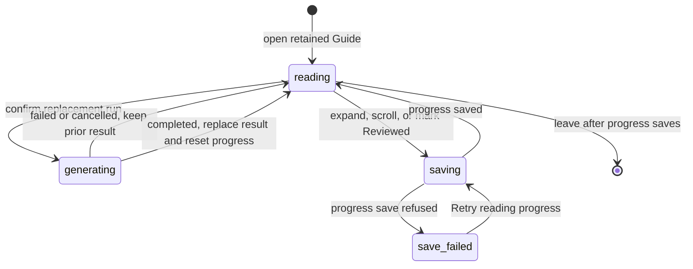

# Guide

## Summary

Guide is an optional Insight in the Review workbench. It groups changed files by behavior and places each explanation beside its retained file evidence. Generation starts only on request. Guide and Walkthrough are separate readers.

## The simple case

Open Insights and select Guide. Generate Guide opens the [Insight run dialog](brief.md#begin-an-action). Choose Codex CLI account or pi CLI account, then a model, reasoning level, and language. Confirm the run to start generation.

A compact toolbar shows the file count, group count, Reviewed progress, and View menu. Numbered groups have an explanation and expandable file rows. Others holds changed files outside the groups. Expanding a row shows that file's complete retained diff, including changes the group explanation does not discuss. Repeated appearances expand independently.

Groups, file lists, and long text load in pages. Show more files continues a list; Show the rest of this explanation continues a long explanation. A short notice remains visible when source context is partial or its completeness is unknown.

Mark reviewed records progress for one group. Viewed records progress for a file and is shared with Diff and every Guide appearance. Neither action submits a GitHub review. Notes, comments, replies, and drafts use the [shared inline actions](inline-conversations.md).

The wide minimap rests as a compact rail, with small Previous and Next controls aligned with its resting ticks. Pointer or keyboard focus opens a text-only preview with the group number, title, explanation, and Reviewed badge when applicable. The preview is 320 by 240 CSS pixels, capped by the available viewport. It contains no file list, file count, or action. Clicking the rail jumps to its group. At narrow widths, selecting a group name jumps immediately; Preview opens its text preview. File links remain in the main Guide reader. Navigation stays reachable while reading a long expanded file.

## The task, event by event

### Arrive

Opening Guide does not start a run. Only a saved result in the new paged format is readable; earlier-format Guides and their reading progress are not imported. An outdated result keeps its own patch rather than showing newer source. Without a readable result, the reader offers Generate Guide. A saved failed run shows its failure separately, including whether an earlier result remains available.

At wide widths, the current group's title and review control stay docked on the left while the files and diffs scroll on the right. A long explanation scrolls within the available height beneath the title and control. Groups share one continuous reading area; files do not each get a vertical scrollbar. Narrow layouts stack the explanation above its files. The minimap's current indicator follows the visible group. A check identifies a Reviewed group, independently of the current marker. Equal marker spacing represents group order, not the relative height of each group.

### Leave unchanged

Reading a retained Guide starts no provider work or GitHub write. Scrolling saves reading position. Leaving and returning restores Reviewed groups, expanded appearances, and the position within the same retained result. Review drafts follow their shared [persistence and recovery rules](../foundations/persistence-and-recovery.md).

### Begin an action

Generate Guide, Regenerate, or the Guide row in Run Insights opens the run controls. Only confirming the run starts generation. The run uses the represented revision and its complete changed-file inventory.

Every entry point, including Try again and agent-request approval, offers the two native CLI accounts. Retired or unavailable saved providers use the [shared opening defaults and replacement notice](brief.md#begin-an-action). The single Start button names the provider and model, and batch rows show each choice. Opening or cancelling saves nothing; only an accepted start saves the replacement. Unavailable models keep Start disabled.

Hovering or focusing the desktop rail opens a preview. Arrow keys, Home, and End preview groups before Enter or Space selects one. The preview has no focusable actions. Escape closes it and returns focus to the rail or compact Preview control. The opened narrow group list wraps long names; its closed trigger can truncate them.

A file row expands or collapses only that appearance. Text diffs show code without a Patch metadata disclosure. Nontext evidence displays its retained metadata directly. Each file has one filename, status, and actions header. The information button explains why the file belongs to its group without repeating that prose above the code. A single View menu applies to all expanded files, including files opened later. Markdown Preview remains available for eligible retained files.

### While the action runs

The run captures the represented revision before generation. The model reads captured diffs as plain files and can open captured head files for surrounding code. A newer checkout or pull request revision cannot replace those bytes. Missing or changed required evidence fails the run and keeps the previous result readable. See [local storage and privacy](../cross-cutting/local-storage-and-privacy.md#while-the-action-runs) for account-provider permissions and diagnostic detail.

Guide uses the shared [Preparing, Running, and Cancelling lifecycle](brief.md#while-the-action-runs). The workbench stays usable during preparation. Empty or unindexable patches, captured patches over 64 MiB, and unavailable required evidence fail preparation without invoking a provider. Captured head text is limited to 512 KiB per file and 4 MiB per run. Skipped snapshots do not remove files from the complete patch and inventory. Change intent remains excluded.

The model submits groups and supporting files in small batches. Patchdesk validates the complete submitted result before making it readable. There is no twelve-group cap; the model chooses how many groups to create. Others still contains files outside those groups, not a promise that their changes are unimportant.

If the model tries to finish with ungrouped files, Patchdesk keeps generation open and returns their count, counts by change status, and up to twenty of the largest remaining changes. The model can add supporting files or explicitly confirm that the remaining files belong in Others. Finishing with every file grouped needs no confirmation. This check imposes no group count or coverage percentage and does not prove that the model inspected every file.

A previous result remains readable during regeneration. Failure and run progress appear separately from that result. Cancel run requests cancellation; cancellation is not complete until the run settles. A known active run keeps its cancellation control when result pages cannot be read or GitHub freshness becomes unavailable.

One compact phase and action block shows Preparing, Running, or Cancelling, with elapsed time when available. Activity starts closed and appears only when a bounded trace is available. The shared Run Insights controls show common or Mixed values from selected editable rows, with optional row overrides. See [Brief](brief.md#begin-an-action) for those controls.

If a recorded provider request has an unknown outcome, the run pauses rather than sending it again automatically. Start new generation opens an acknowledgment that another generation may spend again and does not recover the missing responses. No request is sent until that acknowledgment is confirmed. Cancel run remains a separate action.

A pause without enough recovery or cessation evidence keeps Start new generation disabled and hides the spend acknowledgment. The notice explains that cleanup or recovery is not confirmed. With no recorded provider requests or native turn starts, it reports that absence rather than claiming unknown responses or spend. With recorded activity, it warns of possible account spend. Cancel and stale-Review restrictions still apply.

Reading progress updates immediately while Patchdesk saves it. A failed save keeps the displayed progress and offers Retry reading progress. Navigation that would leave the Review waits for its registered progress saves. If they fail, Patchdesk keeps the current Review open.

### Settle

A validated, saved result replaces the prior Guide. It starts at the beginning with collapsed files and no Reviewed groups. Shared Viewed marks and review drafts are not reset by regeneration.

A failed, cancelled, or superseded replacement does not erase the prior retained result or its progress. An invalid result never replaces readable evidence. A later successful retry replaces the result normally.

Failed, cancelled, and superseded runs keep distinct messages after reopening. Try again appears only when the recorded failure permits a retry and the current Review can run one. Cancelling or superseding a run does not itself offer a retry button.

A cancelled replacement with a readable result shows one short statement that the previous result is displayed. Its information button opens run details without shifting the reading area. Failure explanations and recovery actions remain visible. Run details show safe run and native attempt metadata, keeping the first host failure separate from history capture and cleanup outcomes. Readable history has unknown completeness. Missing history does not remove recovery, and run details do not expose private paths or native bodies. A retired API generation cannot resume through a native provider.

## Variants

| Variant                                                | Before the action runs                                                                                      | While the action runs                                                                                                              |
| ------------------------------------------------------ | ----------------------------------------------------------------------------------------------------------- | ---------------------------------------------------------------------------------------------------------------------------------- |
| Workspace profile and GitHub account                   | The active workspace scopes the Review, retained Guide, and provider choices.                               | Responses stay with their captured workspace and Review session.                                                                   |
| Pull request and Review state                          | Pull request and local Reviews can have Guides. Closed or merged Reviews keep retained evidence readable.   | A newer represented revision can supersede generation. Older retained evidence remains distinct.                                   |
| GitHub permissions and merge readiness                 | Reading and generation make no GitHub write. Inline actions need their own permission and freshness checks. | A Guide run grants no new write authority. Shared actions retain the workbench's checks.                                           |
| Network, local tool, and Insight provider availability | Missing provider configuration or required represented evidence can prevent generation.                     | Provider, timeout, validation, or storage failures preserve the prior result. Reading retained evidence needs no new provider run. |
| Input path: mouse, keyboard, or desktop menu           | Pointer and keyboard reach the same controls. No desktop command starts generation without confirmation.    | Desktop navigation and close commands use the shared leave and write guards.                                                       |

## Cancel and interrupt

| Event                                                                                                 | Before the action runs                                                                                                       | While the action runs                                                                                                                                                                                 |
| ----------------------------------------------------------------------------------------------------- | ---------------------------------------------------------------------------------------------------------------------------- | ----------------------------------------------------------------------------------------------------------------------------------------------------------------------------------------------------- |
| Cancel, Stop, or Escape                                                                               | Escape closes the active preview or dialog without changing Guide content.                                                   | Cancel run requests cancellation independently of file-authoring freshness. Escape cannot bypass a pending write or leave decision.                                                                   |
| Navigate to another Patchdesk screen, Review, Settings section, or workspace profile                  | Registered reading progress must save before leaving its Review. Shared unsaved review text can require a separate decision. | Failed progress saves hold the destination. A pending GitHub write still blocks leaving.                                                                                                              |
| Start another action or request a refresh                                                             | Each control checks its own availability. Viewing or navigating Guide does not start a replacement.                          | Conflicting work follows the shared run and Review owners. Newer responses cannot adopt an obsolete session.                                                                                          |
| GitHub, the network, a local tool, or an Insight provider fails or times out                          | Unavailable prerequisites prevent generation and explain the failure.                                                        | A failed run keeps the previous result. A progress failure offers Retry reading progress. An uncertain GitHub write follows shared recovery, without replay.                                          |
| Close Settings, reload the renderer, close the window, or quit Patchdesk                              | Closing Settings does not erase progress. Renderer reload restores confirmed local state.                                    | Approved app close and quit wait for registered progress saves. Failed saves offer Keep reviewing or Retry. A pending GitHub result prevents close. Abrupt termination restores only confirmed saves. |
| The pull request, represented revision, pending review, permission, or other target changes elsewhere | Current Review evidence determines authoring availability. An outdated Guide remains readable.                               | Obsolete progress updates cannot overwrite a replacement Guide. Shared write checks refuse stale authoring.                                                                                           |
| macOS focus, a file or folder picker, or another input path takes control                             | Focus loss alone does not change Guide content or start generation.                                                          | No effect on run identity or confirmed progress.                                                                                                                                                      |

## Interactions with other systems

**Workspace profile and identity.** Guide progress belongs to one retained run and Review session within its workspace. Another workspace or Review cannot inherit it.

**Review revision and freshness.** Retained file evidence belongs to the Guide's represented patch. See [Review session and revision](../foundations/review-session-and-revision.md). Outdated Guide evidence cannot authorize a current-revision comment.

**Local persistence and recovery.** Reviewed groups, expanded appearances, and a position within a group or file are saved locally. Resize and tab return restore that content position rather than an old document pixel height. Successful replacement resets only Guide reading progress.

Reading progress belongs to the exact saved result. Reopening and returning from another Insight reread current progress rather than combining new marks with an old position or save version. Earlier-format progress is not restored into a new-format Guide.

**GitHub permissions and write authority.** Guide uses the same [inline conversations](inline-conversations.md) and [pending review](pending-review-and-finish.md) as Diff. Typing, navigation, and generation do not publish. A successful action clears only the confirmed draft, not newer text.

**Network, local tools, and Insight providers.** Generation uses the chosen provider and represented Review input. Invalid evidence or context and inventory beyond their supported limits is rejected rather than silently dropping changed files. The model reads the retained evidence files rather than the current checkout.

**Concurrent operations and locking.** Progress saves are serialized and reject stale result identities or versions. Shared GitHub actions preserve the [write safety rules](../cross-cutting/write-safety-and-freshness.md).

**Feedback, errors, and diagnostics.** Run failures and reading-save failures have separate feedback. Unavailable authoring states show a reason while retained evidence stays readable.

**Preferences, keyboard commands, and desktop integration.** View choices are local to the mounted Guide reader and do not overwrite global Diff preferences. Full context is unavailable because Guide has only retained patch context. On macOS, closing the window and quitting the app are separate actions. Quit stops the local API after progress saves finish.

**Supported input and accessibility limits.** Guide supports mouse and keyboard input. It makes no claim for screen readers, touch, or pen.

## Edge cases

- A file can support several groups. Its expansions remain independent; its Viewed mark and review content remain shared.
- Others lists each ungrouped file once and has no Reviewed group state. It may be empty.
- Renamed, deleted, binary, submodule, omitted, and metadata-only files keep their retained evidence labels or metadata.
- Long preview text is clipped within the fixed box, without internal scrolling; the main Guide retains the explanation. Many group markers scroll within the rail; keyboard preview reveals the chosen marker without moving Guide.
- Group or file navigation changes only reading position. It preserves expansions, Reviewed, Viewed, and unsaved review text.
- Readable Guides are retained across failed or cancelled replacement runs. Reading state does not transfer to a different successful result.
- A stale Guide permits inspection and local reading progress, but not authoring against its older revision.
- The minimap is adapted from T3 Code and includes its MIT notice in the shipped renderer.
- The docked explanation can take keyboard focus and scroll with Page Up or Page Down. File expansion and information buttons remain keyboard accessible; Escape returns focus from an information popover to its button.

## Open questions and verification

- Captured-file generation and optional head snapshots follow the slice 2 source change after `5ac4d3c5`, under [ADR 0057](../../adr/0057-read-captured-insight-evidence-as-plain-files.md). On 2026-10-27, Codex CLI account runs published Guides grouping 53 of 53 files and 61 of 516 files. The latter regressed from 131 grouped files; coverage remains with #830. Result screenshots and Pi generation for this change remain unverified.
- [Guide checklist](../verification/insights-and-cross-cutting.md#review-workbenchguidemd) records generation, retained evidence, navigation, restoration, and recovery checks.
- Before API retirement, the paged API-key path generated a real Guide with DeepSeek on the 516-file PR #140. CDP checks confirmed its 12 groups and 258 Others, file expansion, Open in Diff selecting the same file, saved Reviewed and expansion marks, tab-return position restoration, and reopening after a full dev-app restart without another provider dispatch. The source context completeness notice was inspected after it loaded.
- Native Guide generation and reopened readers were checked through both CLI accounts. A fresh Pi Guide also completed after removal of the API runtime. These checks establish the observed generation and reading paths; they do not establish every cancellation, interrupted recovery, or Review-source variant.
- Publishing replies, edits, deletions, and review submissions from Guide was not exercised against a real pull request. Owning tests cover those actions; a disposable live write pass remains pending.
- Native-only provider selection and safe history details follow [ADR 0056](../../adr/0056-run-insights-through-native-cli-accounts.md). Final shared-control and failure-layout acceptance is tracked separately from the earlier preview checks.
- The parent inspected first, middle, last, and 560-pixel-wide previews on the real PR #140 Guide. The final preview had no file count or actions, and Escape restored trigger focus. These checks cover the preview correction, not the whole page.

Drafted against Patchdesk application source commit `b960ff0c292053dd514e6bd33950c542bf92cd10`. Layout checked through CDP; native and fixture evidence limits are stated above.

Paged generation, reading, progress, and failure behavior revised from source commit `e90d1ef8b733404004eb2e30796256c5ac06b526` for #821. The successful-run evidence and remaining lifecycle limits are stated above. Generation across every Review-source variant remains unverified.

Preview behavior follows committed source `8d8600d8`; locked-pause presentation follows `7c9833ce`. The scoped parent checks above preceded those commits and do not establish full lifecycle verification.

Native-only controls, collapsed Activity, safe Details, and acknowledgment behavior are revised from the uncommitted source following `a18b0753` on 2026-10-25, under [ADR 0056](../../adr/0056-run-insights-through-native-cli-accounts.md). Final desktop and narrow acceptance for those controls remains pending. Successful native lifecycle checks do not establish useful explanation coverage; that follow-up is tracked in [#830](https://github.com/kwanpham2195/patchdesk/issues/830).

The compact reading layout was checked over CDP on 2026-10-25 using a saved 516-file Guide. Checks covered a large expanded diff, docked group transitions, member pagination, exact scroll restoration after reload, keyboard expansion and popover focus, a short window, and stacked layouts at 900 and 560 pixels. No provider work or recovery action was started. Current authoring was unavailable on that Review, so this pass does not verify publishing comments.
