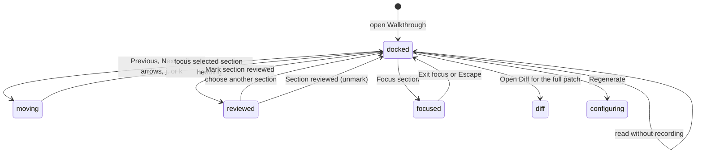

# Walkthrough

## Summary

Walkthrough is a generated, guided reading sequence for one represented Review revision. It groups chapters and sections, pairs prose with representative diff hunks, counts hunks it does not explain, and records local section-reviewed markers. The maintainer reaches it from the Walkthrough tab or card in Insights, or from Open walkthrough in the Brief header. It opens in a docked layout beside the ordinary Insights chrome; Focus section switches to a focused layout that hides that chrome. It is a reader inside the Review, not a GitHub review action.

## The simple case

The maintainer opens the Walkthrough. If none exists, a borderless empty state centers the Walkthrough icon, the heading "No walkthrough yet", a one-line explanation, and the Generate walkthrough action in the available reader space. With a retained Walkthrough, they read the active section and its cited diff hunks, move with Previous section, Next section, the chapter rail, the arrow keys, or plain `j` and `k`, and mark sections reviewed, or unmark one by pressing Section reviewed again. When they want fewer distractions they choose Focus section, and Escape brings the docked layout back. The chapter rail shows how many hunks the reading path does not explain and links to the full Diff.

Generation needs an API key. Codex CLI account and pi CLI account selections are currently refused, even though the shared run dialog still offers them. Opening a saved Walkthrough needs no provider. Earlier-format Walkthroughs show unavailable with Regenerate rather than an older reader.

## The task, event by event

### Arrive

The reader opens on the saved current section when it is still valid, or on the first section. It always opens docked. Opening the Walkthrough does not move keyboard focus.

The docked layout keeps the Insight tab strip and the Walkthrough's own title above the reader. A muted meta line at the right end of the tab strip shows when it was generated ("Generated 7h", or "Outdated · generated 7h"), the provider and model, the language when it is not English (for example "Vietnamese"), and a Regenerate button. On a window at least 1280 pixels wide, the chapter rail sits in a column on the left; on a narrower window it sits above the reading surface with a limited height.

The chapter rail is headed Chapters and shows progress as the current position and the reviewed count, for example "2/5 · 1 of 5 reviewed" on one line beside the heading. It loads section links in windows, with Previous chapters and More chapters to reach other windows. Each link has a two-digit number, the section title with the full title on hover, and a "done" badge for a reviewed section. The active section is highlighted. Below the chapters, a visible count shows cited hunks out of all changed hunks and labels the remainder as not explained in the reading path. Open Diff switches to the full patch; the uncited hunks are not listed or marked reviewed as a group in the Walkthrough.

The reading surface shows a chapter-context eyebrow, the complete current section title, the generated prose, a badge counting the section's hunks, a "reviewed" badge when the section is reviewed, and the Focus section button. The cited hunks follow, then Mark section reviewed, Previous section and Next section. The focused layout adds the position as "N of M"; the docked layout leaves it to the chapter rail. A one-section Walkthrough omits Previous section and Next section. A zero-section Walkthrough reports 0, omits Mark section reviewed, and keeps no fabricated active section.

When the Walkthrough is current, each cited hunk takes notes and comments as the Diff tab does. The `+` in the gutter beside a hovered line opens a composer for that line, and dragging it across lines of the hunk opens one composer for the range; a drag that leaves the hunk opens none, and the Diff tab's notice says why. A local Review gets a [note](../pull-requests/opening-a-local-review.md#maintainer-notes), and a pull request Review gets Comment now, Start a review, or Add review comment, as [Inline conversations](inline-conversations.md) describes. Both land in the Diff tab's lists: a note or pending comment written in the Walkthrough shows inline on the Diff tab and in Notes, and one written on the Diff tab shows on its cited hunk here, across all its lines. A note written here records Combined as its view, because the Walkthrough shows Combined line numbers whichever view the Diff tab shows. A Walkthrough of an older revision numbers the lines of another diff, so its hunks have no gutter `+`.

When the Walkthrough is current and its inline discussion is available, the cited hunks also show the pull request's open and resolved inline conversation threads that fall on those lines, with Reply, Resolve, Edit, and Delete as on the Diff tab. Inline discussion is available only when the Walkthrough is current and verified, the Review is Fresh, the represented patch is loaded, the inline conversation has fully loaded, and the Walkthrough was generated for this exact profile, session, head, and patch. Otherwise the reading surface names the next step: an outdated Walkthrough says "Older revision; regenerate to see replies.", and every other cause says "Discussion unavailable; refresh to check."

Only the current saved format is readable. Earlier-format Walkthroughs show unavailable with a single Regenerate action on an eligible open Review. Their saved content and progress stay stored, but are not imported. Repeated files keep separate cited hunks rather than combining them into one diff.

### Leave unchanged

Reading, scrolling, changing diff layout or wrapping, switching between docked and focused layouts, and leaving without marking reviewed do not change GitHub or the generated Walkthrough. A note, comment, reply, or Resolve made on a cited hunk writes as it does on the Diff tab. Moving to another section saves the current section locally; it records no reviewed marker.

### Begin an action

For multiple sections, Previous section and Next section move one section and disable at the first and last boundaries. The chapter rail can jump directly to a section. The Left arrow and `k` move to the previous section; the Right arrow and `j` move to the next, matching the Vim convention. These keys act only when no text field, select, or combobox has focus. One-section and zero-section Walkthroughs omit the movement buttons.

Mark section reviewed records the current section's stable identity and is offered only while the Review is open. On a reviewed section the same button reads Section reviewed and removes the mark, with no confirmation. Open Diff switches to the full patch without marking any hunk reviewed.

Focus section hides the Insight tab strip with its meta line, the Walkthrough title, and the chapter rail, and leaves a single reading column. The same button, now named Exit focus, returns to the docked layout. The layout change fades out and back in.

Regenerate opens the shared Insight run dialog described in [Brief](brief.md#begin-an-action). Choose API key and a model. A Walkthrough run in Vietnamese writes its chapter titles, section titles, and prose in Vietnamese. For every language, the prompt asks the model to keep repository domain names, technical terms, paths, and identifiers as written. Regenerate appears in the docked layout for a readable result on an open Review when no run is active, including after cancellation or a failed replacement and for an older revision. Provider availability can disable it.

Run Insights… beside the tab strip starts the Walkthrough together with Brief and Analysis, from one dialog with a row per Insight; see [Brief](brief.md#begin-an-action). The Walkthrough row is seeded from the saved Walkthrough preference, is checked by default only when no current Walkthrough stands for this revision, and is disabled while a Walkthrough runs. Generate walkthrough, Regenerate, Try again, and Run for latest revision keep the single-Insight dialog.

### While the action runs

The run captures the represented revision before generation. Its first request names that revision and an evidence entry; the model reads captured pages as needed. A newer checkout or pull request revision cannot replace those bytes. Missing or changed required evidence fails the run and keeps the previous result readable. Empty or unindexable patches and captured patches over 64 MiB fail preparation without a provider request. See [local storage and privacy](../cross-cutting/local-storage-and-privacy.md#while-the-action-runs) for retained evidence and diagnostic detail.

The reader loads one section at a time. Section movement updates the active prose and cited hunks together and selects the matching chapter window. Citations load in pages with Previous citations and More citations. Visible citation cards load their evidence; off-screen cards do not keep every diff mounted. Each card shows a single captured hunk with its original file header and line numbers. It uses natural height and lets the reader own scrolling. It respects unified or split layout, wrapping, app appearance, and diff theme. Each cited hunk starts from the saved View options of the Diff tab; a change made in the Walkthrough applies only to that hunk and is not saved.

Reviewed markers and the current section are shown at once and saved locally in the background. Controls stay usable while the save runs. Each result has its own progress; a successful replacement starts with no marks. Generation follows the Preparing, Running and Cancelling lifecycle described in [Brief](brief.md#while-the-action-runs) and keeps any readable Walkthrough until a replacement succeeds. The model submits chapters, sections and citations in order. Patchdesk validates them against captured evidence before publishing. There is no fixed chapter or section total and no requirement to explain every hunk. A rejected text field records only the field and counts in diagnostics, not generated prose.

The API-key run shows progress and its start time, not a Codex command trace. Its generation deadline scales with captured input size, from 5 to 20 minutes. Cancel run requests cancellation and shows Cancelling until it settles. A cancelled replacement says "The Walkthrough run was cancelled." and "The previous Walkthrough is unchanged." A readable previous result and Regenerate remain available after settlement.

After an interruption with recorded provider requests whose responses are unknown, the run shows Paused with a static pause indicator. It says "N recorded provider requests whose responses are unknown. Nothing was sent again." Resume as a new generation requires a checkbox acknowledging possible additional spend and a fresh, unchanged, open Review. It does not recover the missing responses or restart the original deadline. Merely reopening, refreshing or reloading never resends a request.

### Settle

After movement, focus moves to the selected section heading and progress reflects the new position. At boundaries, movement stops instead of wrapping.

Escape in the focused layout returns to the docked layout and puts focus on the Focus section button. Escape in the docked layout moves focus to the current section heading. Escape never leaves the Walkthrough.

A reviewed section shows "Section reviewed" on a pressed button and a "done" badge in the rail. Pressing it while the Review is open unmarks the section: the button reads Mark section reviewed again, the rail badge goes, and the reviewed count drops. Saved marks and the current section survive a renderer reload. On a merged or closed Review, saved section markers still show, but the mark button is disabled for a reviewed section and absent for an unreviewed section. Moving between sections there changes only the screen and saves nothing. If a save fails, the reader shows "Walkthrough progress could not be saved." above the Walkthrough while the marker stays on screen.

A validated replacement becomes the saved Walkthrough with empty reading progress. Failure, cancellation or pause preserves the previous readable result and its marks. A failure notice appears separately from that result and remains after reopening. Invalid stored result or progress data reports an error instead of silently clearing marks.

Reviewed indicators are projected for the exact Walkthrough revision. They do not submit a GitHub review, mark files viewed on GitHub, or change pending-review state.

## Variants

| Variant                                                | Before the action runs                                                                                                                                                                                                                                                                                          | While the action runs                                                                                                                             |
| ------------------------------------------------------ | --------------------------------------------------------------------------------------------------------------------------------------------------------------------------------------------------------------------------------------------------------------------------------------------------------------- | ------------------------------------------------------------------------------------------------------------------------------------------------- |
| Workspace profile and GitHub account                   | Walkthrough belongs to a profile-scoped Review session. Viewer identity does not affect reading markers.                                                                                                                                                                                                        | Switching profile leaves the Review; the old section state cannot become another profile's Walkthrough.                                           |
| Pull request and Review state                          | A retained Walkthrough can be read for open or terminal represented Reviews. Generation needs an open Review; on a merged or closed Review, Generate walkthrough, Regenerate, Try again, and Run for latest revision are not drawn. Inline discussion appears only on a current Walkthrough for a Fresh Review. | Remote updates do not rewrite the reader; a newer revision needs its own Walkthrough.                                                             |
| GitHub permissions and merge readiness                 | No GitHub write permission or merge readiness is required.                                                                                                                                                                                                                                                      | Mark reviewed is local and cannot change checks, review decision, or merge readiness.                                                             |
| Network, local tool, and Insight provider availability | A retained Walkthrough is readable without a provider. Generation needs an API key, an available model and prepared context.                                                                                                                                                                                    | Provider failure leaves the retained Walkthrough. Local highlighting failure inside a cited hunk needs live verification.                         |
| Input path: mouse, keyboard, or desktop menu           | Rail, Previous section, Next section, review markers, Focus section, arrow keys, `j`, `k`, and Escape support mouse or keyboard use.                                                                                                                                                                            | Arrow keys, `j`, and `k` are ignored while a text field, select, or combobox has focus or a modifier is held. Desktop menus do not mark progress. |

## Cancel and interrupt

| Event                                                                                                 | Before the action runs                                                                                                                                         | While the action runs                                                                                                                                                                                                 |
| ----------------------------------------------------------------------------------------------------- | -------------------------------------------------------------------------------------------------------------------------------------------------------------- | --------------------------------------------------------------------------------------------------------------------------------------------------------------------------------------------------------------------- |
| Cancel, Stop, or Escape                                                                               | Escape leaves the focused layout, or in the docked layout moves focus to the section heading. No review marker is added by leaving.                            | Cancel run applies only to generation and waits for settlement. The previous result stays readable. A local marker save has no Stop.                                                                                  |
| Navigate to another Patchdesk screen, Review, Settings section, or workspace profile                  | Reading can leave without a write guard. The saved current section and reviewed markers remain local. Returning to Insights opens Brief and the docked layout. | A provider run remains bound to its original session. A section movement cannot target another Review.                                                                                                                |
| Start another action or request a refresh                                                             | The maintainer can choose a different section immediately.                                                                                                     | A new section selection supersedes view movement. GitHub refresh can mark updates without changing the retained Walkthrough.                                                                                          |
| GitHub, the network, a local tool, or an Insight provider fails or times out                          | Existing content stays readable during GitHub or provider failure. An incomplete inline-conversation load replaces thread display with the unavailable notice. | Generation failure is retryable and does not erase retained content. Reviewed markers do not depend on GitHub; a failed local save shows "Walkthrough progress could not be saved."                                   |
| Close Settings, reload the renderer, close the window, or quit Patchdesk                              | Settings overlays the reader according to normal navigation. Saved current section and markers belong to this result.                                          | Renderer reload returns to the docked layout. Restart after an interrupted provider request can show Paused with explicit Resume; nothing is resent automatically. An in-flight progress save at quit may not finish. |
| The pull request, represented revision, pending review, permission, or other target changes elsewhere | A newer remote revision makes this Walkthrough historical for the represented snapshot and removes its inline discussion.                                      | Current section and markers remain bound to the original Walkthrough identity; they cannot confirm the newer revision reviewed.                                                                                       |
| macOS focus, a file or folder picker, or another input path takes control                             | Opening the Walkthrough does not move focus. Arrow keys, `j`, and `k` act only while focus is inside the Walkthrough.                                          | Focus loss does not move sections. Focus return after leaving the focused layout needs live desktop verification.                                                                                                     |

## Interactions with other systems

**Workspace profile and identity.** The Walkthrough is session-scoped; reviewed markers are local reading state, not GitHub viewer state.

**Review revision and freshness.** Every chapter, section, hunk, and marker belongs to one represented revision. Brief opens only the Walkthrough that stands for that revision. Inline conversation threads appear only when the Walkthrough, the session, and GitHub's current revision all agree.

**Local persistence and recovery.** The retained Walkthrough, current section and reviewed markers are stored locally. Progress belongs to one exact result, not just the represented revision. A new result starts with no marks, even if its section IDs repeat. Earlier-format progress is not restored. The docked or focused layout is not saved.

**GitHub permissions and write authority.** Mark reviewed grants no write authority. A comment, reply, or Resolve on a cited hunk goes through the Diff tab's writes and needs what they need: an open, Fresh Review with no recovery lock for a direct write, or a pending review.

**Network, local tools, and Insight providers.** Generation currently uses API keys only. Cited hunk rendering uses retained patch evidence and local highlighting. Inline conversation threads come from the inline conversation the workbench already loaded; the Walkthrough itself makes no GitHub read.

**Concurrent operations and locking.** One retained artifact and active section identity own the reader. Generation is coordinated separately from local movement. A layout switch requested while the previous one is still fading is ignored.

**Feedback, errors, and diagnostics.** Progress, reviewed indicators, inline-discussion unavailability, progress save failure, unavailable generation, and replacement failure are distinct. Earlier-format results are unavailable rather than rendered as unverified prose.

**Preferences, keyboard commands, and desktop integration.** Cited hunks respect current layout, wrapping, appearance, and theme. Arrow keys, `j`, `k`, and Escape are reader-level keyboard behavior.

**Supported input and accessibility limits.** Mouse and keyboard are supported with focused headings and named controls. Patchdesk does not claim screen-reader, touch, or pen support.

## Edge cases

- An empty Walkthrough uses the same centered structure as empty Brief and Analysis readers.
- With multiple sections, Previous is disabled on the first section and Next on the last; movement never wraps.
- A one-section Walkthrough omits Previous section and Next section. A zero-section Walkthrough reports 0 and omits the movement buttons and Mark section reviewed.
- Repeated files use unique block IDs, so different hunks stay separate.
- Deletion-only hunks remain renderable with a preserved file header.
- Full section titles remain available on hover in the chapter rail even when a title is truncated.
- The chapter rail counts every uncited hunk without listing them as a Walkthrough section. Open Diff leads to the full patch when it is loaded. Uncited does not mean unimportant.
- The count and Open Diff are in the chapter rail, so they are unavailable in the focused layout.
- Pressing Section reviewed on an open Review unmarks the section and removes its rail badge.
- `j` moves to the next section and `k` to the previous, so the letters follow Vim while the arrows follow reading direction.
- The Left and Right arrows move between sections rather than scrolling a wide hunk sideways.
- Arrow keys, `j`, and `k` do nothing while a text field, select, or combobox has focus, or while Command, Control, Option, or Shift is held.
- Escape can focus the current section heading without changing reviewed state.
- A reviewed marker stays on screen even when its save fails.

## Open questions and verification

- The parent verified the paged API-key reader on PR #140 with deepseek-flash on 2026-10-23. The first run published 30 sections citing 89 of 1,676 hunks in about 5.5 minutes. A resumed generation later replaced it with 14 sections citing 43 hunks. These counts are observations, not targets or limits.
- That pass confirmed chapter windows, one-section reading, original hunk line numbers, uncited count and Open Diff, `j` movement, saved marks and current section after reload, and empty marks for a new result. Cancel settled in about 10 seconds with the previous result unchanged and Regenerate available. Restart interruption showed Paused and the explicit Resume acknowledgment. This records the parent's live evidence, not a new documentation-session check.
- The [Walkthrough checklist](../verification/insights-and-cross-cutting.md#review-workbenchwalkthroughmd) distinguishes those checks from pending focused/narrow layout, complete keyboard boundaries, native quit/restoration and inline-write checks. Account-provider parity, Local/MCP live acceptance and pinned W1 acceptance remain pending under #821.
- Outdated Walkthrough wording changed after [UX-12](../ux-friction.md#ux-12-the-inline-discussion-notice-does-not-say-what-failed), but is not live-verified.
- Confirm layout fade, scroll and focus, section and reviewed state after quit, and highlighting fallback.

Baseline drafted from Patchdesk application source commit `3100615`; earlier reader checked against `737c515c`. Notes, comments and thread replies on cited hunks from #598 remain unverified live on the paged reader.

Paged generation, reading, progress and lifecycle revised through source commit `95ded64cd91ed918a4dfb62f46bd2f337e26ec0e` for #821. Earlier Codex Walkthrough checks used the retired producer and do not establish account-provider parity for this format.
